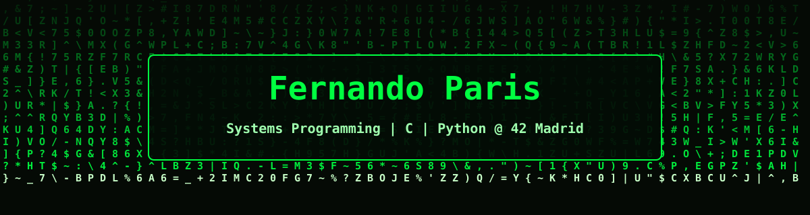

  

  

---

### 👨‍💻 About Me

**Software Developer** with background in game development (**Unity / Unreal Engine**) and low-level systems engineering at **42 Madrid**. Focused on systems architecture in **C/C++** (manual memory management, UNIX processes/signals, 3D graphics rendering) and software development in **Python** and **C#**.

- 🔭 **Currently building:** `Python Modules / Core 42 Curriculum`
- 🧠 **Engineering focus:** Systems architecture, game engine tooling, algorithmic optimization, and zero-leak memory management.
- 📍 **Based in:** Madrid, Spain
- 📫 **Connect:** [GitHub](https://github.com/ryskeman) · [LinkedIn](https://www.linkedin.com/in/fernandoj-fernandezparis/)

 

---

### 🛠️ Tech Stack & Tools

  
  
  
  
  
  
  
  
  
  

  
  
  
  

---

### 🏗️ Core Competencies & Architecture

- **Low-Level Systems & Concurrency:** Process synchronization, bitwise client-server IPC via UNIX signals ([Minitalk](https://github.com/ryskeman/Minitalk)), and custom file descriptor buffering ([GNL-42Next](https://github.com/ryskeman/GNL-42Next)).
- **Algorithms & Data Structures:** Custom `libc` and linked list implementations ([Libft-42Next](https://github.com/ryskeman/Libft-42Next)), variadic function parsing ([ft_printf-42Next](https://github.com/ryskeman/ft_printf-42Next)), and complexity-bounded sorting algorithms ([push_swap-42Next](https://github.com/ryskeman/push_swap-42Next)).
- **Graphics & Mathematics:** 3D isometric wireframe rendering and integer-based rasterization using Bresenham's line algorithm ([42FdF](https://github.com/ryskeman/42FdF)).
- **Object-Oriented Python:** Modular design, exception handling, and data structures ([Python-Pool-42Next](https://github.com/ryskeman/Python-Pool-42Next)).

> *Note: Repositories tagged with `-42Next` belong to the updated 42 Network curriculum.*
